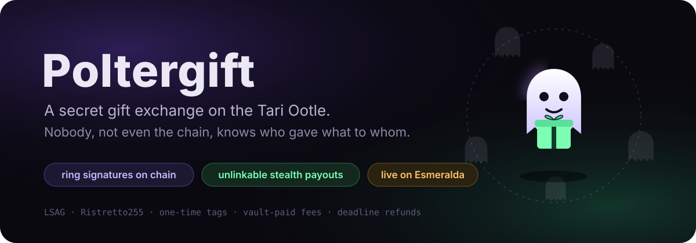
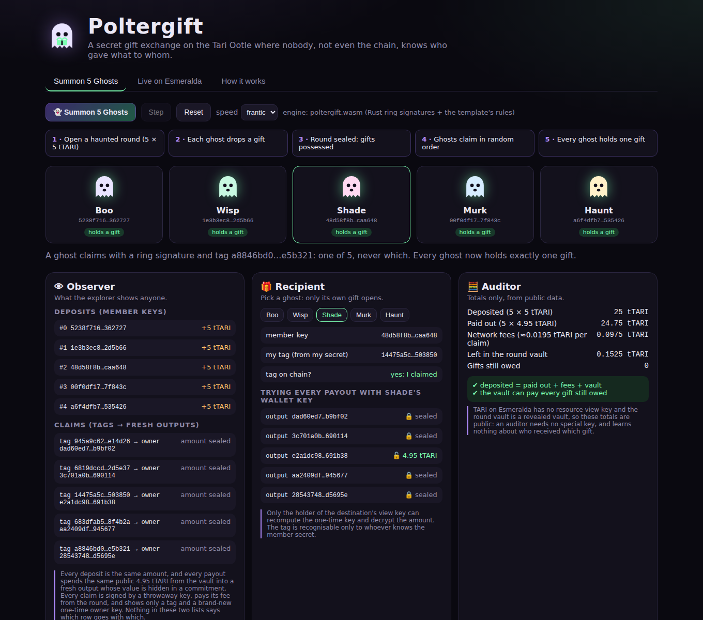
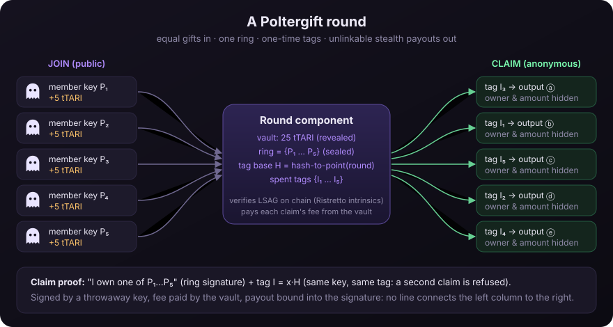

<p align="center"></p>

# Poltergift

**A secret gift exchange on the Tari Ootle where nobody, not even the chain, knows who gave what to
whom.** A group joins a *haunted round*: each ghost drops one equal gift of tTARI under a fresh
member key, ideally paid from a stealth coin. When the round is full the gifts are *possessed*. Each
member then claims one gift into a brand-new stealth output, proving on chain only "I am one of
the members of this round" with a linkable ring signature, plus a one-time tag that stops a
second claim. The claim is sealed by a throwaway key and its fee is paid by the round itself. An
observer sees N equal deposits in and N unlinkable stealth payouts out, and each recipient can open
only their own gift. If a round never fills, or a ghost vanishes, deadlines let depositors take
their gift back.

**▶ Browser demo (no wallet, under 2 minutes):** <https://itsolaph.github.io/poltergift/>
(or run it locally, see [Quick start](#quick-start)) · **Live rounds:** [deployment table](#live-on-esmeralda) ·
**Threat model:** [THREAT_MODEL.md](THREAT_MODEL.md) · **Design notes:** [NOTES.md](NOTES.md)

## Two-minute tour

1. Open the [browser demo](https://itsolaph.github.io/poltergift/) and press **Summon 5 Ghosts**
   (about 15 seconds). Five ghosts open a round, drop gifts, seal it and claim in random order.
2. Look at the three panels: the **Observer** list of deposits and claims has nothing that pairs
   them, the **Recipient** panel opens only the selected ghost's own gift, and the **Auditor**
   totals balance.
3. Click every button in the **Attack lab**: double claim, outsider, redirected payout, replay from
   another round, early refund, wrong gift, key theft. Each is refused with the template's own
   message.
4. Open **Live on Esmeralda**: the same thing on the real testnet, read straight from the public
   indexer, with every transaction linked to the explorer.

<p align="center"></p>

## How it works (30 seconds)

<p align="center"></p>

```
 join ×N          P_i + PoP + exactly g TARI ─┐
 (public)                                    ▼
                         ┌────────────── round component ──────────────┐
                         │ vault (revealed)   ring {P_1..P_N}  tag base H │
                         │ spent tags {I}     deadlines (epochs)          │
                         └───────────────────────┬──────────────────────┘
 claim ×N   LSAG over the ring + tag I = x·H     │  fee intent, throwaway signer,
 (anonymous)  signs the exact payout statement   ▼  fee paid by the vault
                         one fresh stealth output: one-time owner key, amount hidden
```

1. **Join**: a fresh member key `P = x·G` per round, a Schnorr proof of possession bound to the
   round, and exactly the gift amount in TARI. The `N`-th join seals the ring.
2. **Claim**: an LSAG ring signature (Liu–Wei–Wong, per-round generator `H`, bLSAG layout) over
   Ristretto255, verified inside the template with the engine's native intrinsics. The key image
   `I = x·H` is the one-time tag. The signature also signs the CBOR of the payout statement, so the
   payout cannot be redirected.
3. **Payout**: exactly `gift − claim_fee` into a single new stealth output. The claim runs in the
   fee intent, the round vault pays the fee, and a throwaway key seals the transaction: nothing in
   it points at a member or an account.
4. **Refund**: after the join deadline (round never filled) or the claim deadline (round sealed), a
   DLEQ proof (a ring signature with a ring of one) shows `P = x·G` and `I = x·H`. A member whose tag
   is already spent cannot also refund.

## Quick start

Requirements: Rust (stable, with `rustup target add wasm32-unknown-unknown`) and Node 20+.

**Browser demo**

```bash
cd web
npm ci
npm run build        # compiles poltergift.wasm from crates/wasm and bundles the site into web/dist
npm run serve        # http://127.0.0.1:8000  (any static file server works)
```

Press **Summon 5 Ghosts**: five ghosts create, join, seal and claim a round in your browser in about
15 seconds, using the same Rust ring-signature code and the same round rules as the template (the
model is replayed against the real template in CI). Then try the three views, the attack lab and the
**Live on Esmeralda** tab, which reads the real rounds from the public indexer.

**Tests**

```bash
cargo test --workspace                      # ring crate, model, client, CLI, WASM engine
cd template && cargo test --release         # template in the official Tari engine (attacks, fees, equivalence)
cd web && npm test                          # browser engine smoke test (after npm run build)
```

**Reproduce the live check**

```bash
cargo run -p poltergift-cli --example live_esmeralda -- deployments/esmeralda.json
```

It reads every recorded round from the public Esmeralda indexer through the ootle-rs light client
and checks that the ring and tags match, that no payout transaction is signed by a member key, a
join signer or another payout's signer, and that payout outputs carry no amount.

## CLI

```bash
cargo build --release -p poltergift-cli        # → target/release/poltergift
P=target/release/poltergift

$P init                                         # wallet in ./.poltergift (secret: keep it out of git)
$P balance
$P publish --wasm template.min.wasm             # once per network (see "Build the template")
$P round create --template template_… --gift 5 --size 5 --join-epochs 3 --claim-epochs 8
$P round join component_… --from-utxo COMMITMENT:VALUE   # gift from a stealth coin: no account in the tx
$P round join component_…                       # or from the account (links the account to the round)
$P round status component_…
$P round claim component_…                      # anonymous claim to a fresh stealth output of this wallet
$P round refund component_…                     # after the relevant deadline
$P inspect component_… --as-member DIR …        # observer view, plus which payout each member key opens
$P scan                                          # find and open this wallet's stealth outputs
$P bots --template template_… --size 5          # a whole round with freshly generated bot wallets
```

Global flags: `--network esmeralda|localnet`, `--indexer URL`, `--data-dir DIR`, `--record FILE`
(appends public facts such as addresses, transaction ids and tags to a JSON record, never secrets) and
`--trust-indexer` (skip proof verification; for a quiet local network only).

**Build the template**

```bash
cd template
cargo build --target wasm32-unknown-unknown --release
npx -p binaryen wasm-opt -Oz --enable-bulk-memory --enable-sign-ext --enable-nontrapping-float-to-int \
  --enable-mutable-globals --strip-debug --strip-producers --strip-target-features \
  target/wasm32-unknown-unknown/release/poltergift_template.wasm -o template.min.wasm
```

## Live on Esmeralda

<!-- LIVE_TABLE_START -->
Everything below is on the public Esmeralda testnet; links go to the [Veil explorer](https://explorer.tari.mw).
The record is `deployments/esmeralda.json` (regenerate this section with `python3 scripts/live_table.py`).
Funding came from CPU-mining Esmeralda L1 and burning to the Ootle, because the testnet faucet was empty.

Refused live (dry-run rejections by the deployed template, so no transaction was recorded):
round 3 refund before the join deadline (`round is open and the join deadline has not passed`) and
a second refund (`member already refunded`); round 4 early refund (`round is sealed and the claim
deadline has not passed`), refund by the member who had claimed (`gift already claimed with this
tag`) and a claim after the deadline (`claim deadline has passed`).

Rounds 2–4 are deliberately small, to show the deadline paths; their anonymity sets are 3, 2 and 2
members, which is exactly as private as that sounds. Use larger rounds for real gifts.

`cargo run -p poltergift-cli --example live_esmeralda` re-reads all four rounds from the public
indexer and passes every check; with the member wallets (`--as-member`) each one opens exactly its
own payout.

| what | address / transaction |
|---|---|
| template (204,708 bytes, blake2b `748fcf79853dee3c…`) | [`template_3614a1af77d00…`](https://explorer.tari.mw/template/3614a1af77d007558b1cdc14d97d982ce21e22321abad8d7452e1607fb18c047) · publish [`78e23e6bfd…`](https://explorer.tari.mw/tx/78e23e6bfdb216c2ee4f13640a20bda2bbbec72ca1bc7abecb9d8cd3939ab066) |
| claim L1 burn | [`51b3dca6fa…`](https://explorer.tari.mw/tx/51b3dca6fa23a916f49274613dfd1fa8c6c4982cf1ca0b60964c2b7c0ee7e036) |
| deposit stealth funds into the account | [`af245432b2…`](https://explorer.tari.mw/tx/af245432b2afcccf3cfdf5efa3b2980ffb625c57edcdd642dc18ef1d2a3b3f46) |
| fund 5 bot wallets (Round 1: five bot ghosts) | [`3e581f315b…`](https://explorer.tari.mw/tx/3e581f315b26d813bcd1389ba126aeeb570051dadcbaaaeb19a5c5c4b92c5dbd) |
| send to a stealth output | [`1516e7ee64…`](https://explorer.tari.mw/tx/1516e7ee641939749e6dac52aab2909c57dc7d37ed9a6dc6a19e46cf379d9127) |
| send to a stealth output | [`f37538c261…`](https://explorer.tari.mw/tx/f37538c261162ae9f1a6fcc087c9b7e79bc0b973940436ed313a03a4b7e33e76) |
| send to a stealth output | [`71c05094e4…`](https://explorer.tari.mw/tx/71c05094e443ec74c595c89eccbb430713d72e2aaaa549c7b5782b2834fb7973) |
| send to a stealth output | [`7f9459227a…`](https://explorer.tari.mw/tx/7f9459227a8dc07c99dc2b12a468e1861707998caea8a460c9c95339fed1b301) |
| send to a stealth output | [`74b6842a2b…`](https://explorer.tari.mw/tx/74b6842a2be54a8f8c1bc9e2239e7fc595894eff5b39b7ed9fa979c51d0e0893) |
| send to a stealth output | [`42254875e0…`](https://explorer.tari.mw/tx/42254875e0f0ef5912fa009b490e40c79f69e51b73529637dae8105093041500) |
| send to a stealth output | [`401d91d112…`](https://explorer.tari.mw/tx/401d91d1129c1eab60b6a1d9709b6f4aa139d9c07a6b120fcc4f31ab9c5367ae) |

**Round 1: five bot ghosts**: [`component_53560445…`](https://explorer.tari.mw/substate/component_53560445049f7bc84d2829ce73438315e41fd04a8e87a8a1fed485acf87ccff1), 5 members × 5 tTARI, claim fee 0.05 tTARI, joins close at epoch 12688, claims at epoch 12690.

| step | transaction | public detail |
|---|---|---|
| create | [`fede1041c2…`](https://explorer.tari.mw/tx/fede1041c25f7bef243263df88447d7a822a49656463804716115760def8ab75) | |
| join | [`23ab254b08…`](https://explorer.tari.mw/tx/23ab254b0864ddf471af1376aca692f29432191c7517670dcb7f707328d98eff) | member key `0ee4941313ca…`, gift from a stealth output |
| join | [`00bf62040e…`](https://explorer.tari.mw/tx/00bf62040e072543ca9d7d07d60a3ae06f5061583f418e403747d3751858d3e4) | member key `1cd0f53e57f3…`, gift from a stealth output |
| join | [`d0a7731123…`](https://explorer.tari.mw/tx/d0a7731123dd97745ae11fe3de107af6f0013e2f77dfa7c862d6df601b7ee430) | member key `880888a1f3a1…`, gift from a stealth output |
| join | [`7a8a256acb…`](https://explorer.tari.mw/tx/7a8a256acbb0835a65d87a5000444bc6c4683c577487fe92cbb7fd94b054db77) | member key `aeadc0544d23…`, gift from a stealth output |
| join | [`dd9329fd0a…`](https://explorer.tari.mw/tx/dd9329fd0a8dfae28d67ea9a1acf5d5ae1fbb154e4c395c097bcadea4e23ffcf) | member key `ec2cb0647a39…`, gift from a stealth output |
| claim | [`c9a83211ca…`](https://explorer.tari.mw/tx/c9a83211ca977120c8b9552403c76df3f734cc1e6d11a85de95e7be01feb11e3) | tag `96aa550465c7…` → fresh output `cc48490cb013…` |
| claim | [`bc4f7d1bd5…`](https://explorer.tari.mw/tx/bc4f7d1bd5d52381bea6be524c428603d0938b1049b8239ce2b5d5a890b675bf) | tag `80d0234a7c64…` → fresh output `b4a27028cd49…` |
| claim | [`7c3186bc29…`](https://explorer.tari.mw/tx/7c3186bc29b7af4e274d937ca71100cbda16127688646ed3021a5a749ad08987) | tag `92ab1083347b…` → fresh output `d29b3c4c0ce4…` |
| claim | [`74537cc04f…`](https://explorer.tari.mw/tx/74537cc04fddba22b5048aea68bb189a8122d16b8fcd3a73bcb1faf6b270e8e7) | tag `007e27d159b0…` → fresh output `a4b6b0236781…` |
| claim | [`67844d3acd…`](https://explorer.tari.mw/tx/67844d3acd40da1d4571c7e42f881830e32425a25aeabcf02694fb9ef59f6572) | tag `aee9ed2baa69…` → fresh output `3c6ea8acc152…` |

**Round 2: three ghosts, all claim**: [`component_a96f42fa…`](https://explorer.tari.mw/substate/component_a96f42fa9a98c5305df60cfcae09f42d6c2a7bee135cb2594d42e21774339140), 3 members × 5 tTARI, claim fee 0.05 tTARI, joins close at epoch 12687, claims at epoch 12688.

| step | transaction | public detail |
|---|---|---|
| create | [`3e40c8ac57…`](https://explorer.tari.mw/tx/3e40c8ac577df3ab3c13c22d38a92b7780a4fe320e4353054f2bce8e2782e7eb) | |
| join | [`d05d59b064…`](https://explorer.tari.mw/tx/d05d59b0643383d5f4f98c94591cf5c24e7f6a2db5a67dc0295f23212f37d7d1) | member key `f480f12731f4…`, gift from a stealth output |
| join | [`4103b76a92…`](https://explorer.tari.mw/tx/4103b76a9245aa609637c74f8a676c46ef91c1ef5f67dec1a77dc92733cdb88e) | member key `5e7d01e4d070…`, gift from a stealth output |
| join | [`b2ad46dd56…`](https://explorer.tari.mw/tx/b2ad46dd5608178eb52ff7d184368b114695ec5604d07621cbf377989e3069c7) | member key `6415d45464ce…`, gift from a stealth output |
| claim | [`b069bf195c…`](https://explorer.tari.mw/tx/b069bf195cb6fa16c10bfdece88f090587bf7bf3d369bc64fcf9aae8ab1ab08b) | tag `78a645249b41…` → fresh output `ca12f0b6f60e…` |
| claim | [`1fbe037cd6…`](https://explorer.tari.mw/tx/1fbe037cd65ca2ef7a86619dcb61bc6a5a925977c7c6a22f7422ff825bc8c8a2) | tag `2c2c8d7423b6…` → fresh output `44b9d177ac32…` |
| claim | [`144e714484…`](https://explorer.tari.mw/tx/144e7144849cc4288dd978273c1f12da1a8ecd22842b0c0ae83f53e5dc057cde) | tag `7ccdf86d1cab…` → fresh output `fca6d4a6223b…` |

**Round 3: a round that never fills (refunds after the join deadline)**: [`component_0264853d…`](https://explorer.tari.mw/substate/component_0264853db4b0db83ef038d59eab37b2168dc4df1ebed7363f23bf19d1cee2e59), 4 members × 5 tTARI, claim fee 0.05 tTARI, joins close at epoch 12687, claims at epoch 12688.

| step | transaction | public detail |
|---|---|---|
| create | [`151b9d527b…`](https://explorer.tari.mw/tx/151b9d527b56a4103ee3e96a978dc512175ee03b416001b490ebdd2edf2aea54) | |
| join | [`277d1206d7…`](https://explorer.tari.mw/tx/277d1206d7d6896a0da0cafc3e0c380975067c298c465414330bdd3e0392466b) | member key `9a8df96a5ac4…`, gift from a stealth output |
| join | [`eccb4cd3d9…`](https://explorer.tari.mw/tx/eccb4cd3d99b7dd03660d51be3bced7c88a73b64c2d43251d6437c2789ba43b5) | member key `9ce4fe5dd444…`, gift from a stealth output |
| refund | [`b58cc5ed5e…`](https://explorer.tari.mw/tx/b58cc5ed5efa334e052473d02c6789e363d6b86619264720859b746ef38cea68) | tag `04bdf7b20ba4…` → fresh output `dcc1940239c7…` |
| refund | [`cf7f6b347a…`](https://explorer.tari.mw/tx/cf7f6b347a3b8e6b48b105aea472365f958243d169ddb890b236b8a29c9950ee) | tag `4af949eb6cef…` → fresh output `8252cb41a50a…` |

**Round 4: two ghosts, one vanishes and takes a refund after the claim deadline**: [`component_ae2414fb…`](https://explorer.tari.mw/substate/component_ae2414fba1b621a0cd5f54191bdc88e1151f4696ad6ce30bef1a4d1dd64e3880), 2 members × 5 tTARI, claim fee 0.05 tTARI, joins close at epoch 12687, claims at epoch 12688.

| step | transaction | public detail |
|---|---|---|
| create | [`d9ceddeeda…`](https://explorer.tari.mw/tx/d9ceddeedafef2d1f8a1829c35ff7cadbd8759f9fd174bb96664616d9c9f1b62) | |
| join | [`ecf7c2f296…`](https://explorer.tari.mw/tx/ecf7c2f29635c0461b72e25d4014d8209d677a90679999ca561c72f8cae06d91) | member key `cc9f8a9f729a…`, gift from a stealth output |
| join | [`0226f3627d…`](https://explorer.tari.mw/tx/0226f3627d1884a0f8bc2e2aff812b49522330914f1483a5ee02d554bb088293) | member key `c678e49a944b…`, gift from a stealth output |
| claim | [`af992212c5…`](https://explorer.tari.mw/tx/af992212c57c7fb07d81f91783a1d017719dce99cd1a8481562c9099e3f80a70) | tag `902bc04a0f4a…` → fresh output `2e3e2424dec0…` |
| refund | [`eea4ec3f85…`](https://explorer.tari.mw/tx/eea4ec3f85bb5d4b7bae7ab2fb4fa0804ff8cd393019416d876043a1873f57d5) | tag `8cb6dd44c64d…` → fresh output `503e8aabdf1a…` |

<!-- LIVE_TABLE_END -->

## Threat model: what is hidden, what still leaks

Hidden: which member received which payout (deciding it is a DDH problem in `(G, H, P_i, I)`); who
signed a claim (a throwaway key, fee paid by the vault); who owns a payout and its value (a Tari
stealth output); and, with `--from-utxo`, which account paid a gift.

Still visible, by design or as a limit:

* **membership**: the N member keys are public (fresh per round; paying from an account links it);
* **amounts**: equal by design, so every payout spends the same public `gift − fee`;
* **timing**: claims are ordered in time, so claim at a random moment;
* **refunds**: a refund shows that this member did not claim;
* **Sybil / n−1**: the anonymity set only counts honest, distinct members;
* **funding graph**: what you do with the payout afterwards is up to you.

The full list, with 41 money-safety threats each mapped to a named test, is in
[THREAT_MODEL.md](THREAT_MODEL.md).

## Tests

All passing (`cargo test --workspace`, `cd template && cargo test --release`, `cd web && npm test`):

| suite | tests | what |
|---|---|---|
| `template/tests/attacks.rs` | 56 | one named test per attack, each asserting the template's exact reject reason (see THREAT_MODEL.md) |
| `template/tests/equivalence.rs` | 2 | 128 random operation sequences replayed against the template and the browser model: same outcomes, same state, vault always solvent, value conserved; plus a scripted sequence through every path |
| `template/tests/happy_path.rs` | 3 | full rounds of 3, 5 and 8 members, claims in scrambled order |
| `template/tests/fees.rs` | 1 | claim cost on the network fee table for rings of 4, 8, 16, and exact vault accounting with real fees |
| `crates/ring` | 15 | sign/verify, linkability, cross-round unlinkability, tampering, malleability, PoP, 2 property tests |
| `crates/model` | 4 | the rules the browser runs |
| `crates/client` | 7 | secret store (0600/0700), round-state decoding, L1 burn proof conversion |
| `crates/wasm` | 4 | the browser JSON API end to end, bad input, FFI round trip |
| `crates/cli` | 2 | amount parsing |
| `web/scripts/test-wasm.mjs` | 1 | the built `poltergift.wasm` plays a full round in Node |

Plus the live check `examples/live_esmeralda.rs`, run against the public indexer (output in PROGRESS.md).

## Costs

Measured in the official engine on the Esmeralda fee table (`template/tests/fees.rs`):

| ring size | claim fee charged | native points |
|---|---|---|
| 4 | 17,651 µT (0.018 tTARI) | 14.2M |
| 8 | 23,480 µT (0.023 tTARI) | 19.6M |
| 16 | 35,135 µT (0.035 tTARI) | 30.5M |

About 1.36M points per ring member (two 2-term multi-scalar multiplications and one SHA-512) on top
of the stealth-output verification. The template binary is 204 KB after `wasm-opt -Oz`; publishing
it on localnet cost 2.2 tTARI.

## Repository layout

| path | what |
|---|---|
| `template/` | the on-chain round template (Rust → WASM) and its engine tests |
| `crates/ring` | LSAG ring signatures, proof of possession, per-round tag base (curve25519-dalek) |
| `crates/model` | the template's rules as plain Rust, used by the browser and checked against the template |
| `crates/client` | wallet store, round state decoding, all round transactions (ootle-rs), output scanning |
| `crates/cli` | the `poltergift` CLI and `examples/live_esmeralda.rs` |
| `crates/wasm` | browser engine: ring + model compiled to WASM with a JSON C ABI |
| `web/` | the static browser demo (vanilla TypeScript, esbuild) |
| `deployments/` | public record of the live Esmeralda deployment |

## Credits

Built only from official Tari material, credited here with licenses:

* [tari-project/tari-ootle](https://github.com/tari-project/tari-ootle) (BSD-3-Clause): crates
  `tari_template_lib`, `tari_template_lib_types`, `tari_template_test_tooling`, `tari_ootle_transaction`,
  `tari_ootle_common_types`, `tari_engine` (via the test tooling), `tari_bor`, `ootle-rs`,
  `tari_ootle_wallet_crypto`, `ootle_byte_type`; the release binaries (`tari_swarm_daemon`,
  validator node, indexer, wallet daemon) used for local rehearsal; the developer docs at
  [ootle.tari.com](https://ootle.tari.com) (stealth resources, privacy, templates, testing, fees).
* [tari-project/tari-crypto](https://github.com/tari-project/tari-crypto) (BSD-3-Clause).
* [tari-project/tari](https://github.com/tari-project/tari) (BSD-3-Clause): the Esmeralda base node,
  console wallet and miner used to obtain tTARI through burn-and-claim, and the gRPC protos.
* The Esmeralda public indexers and the Veil explorer at <https://explorer.tari.mw>.

Third-party libraries: curve25519-dalek (BSD-3-Clause), RustCrypto `sha2` and `blake2` (MIT/Apache-2.0),
`rand_chacha`/`rand_core` (MIT/Apache-2.0), serde/serde_json (MIT/Apache-2.0), clap (MIT/Apache-2.0),
tokio (MIT), proptest (MIT/Apache-2.0), esbuild (MIT), TypeScript (Apache-2.0), binaryen (Apache-2.0).

The linkable ring signature follows J. K. Liu, V. K. Wei and D. S. Wong, *Linkable Spontaneous
Anonymous Group Signature for Ad Hoc Groups* (ACISP 2004).

## License

MIT. See [LICENSE](LICENSE).
